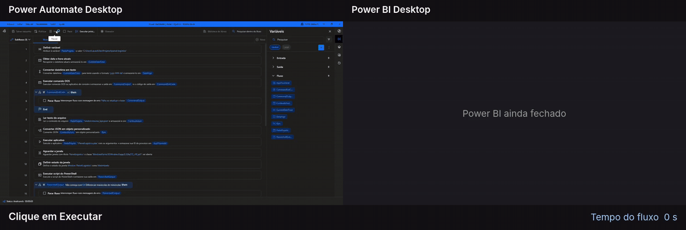
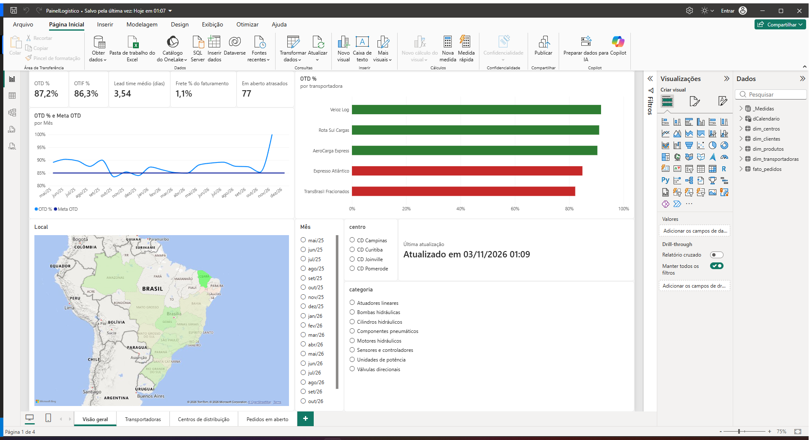
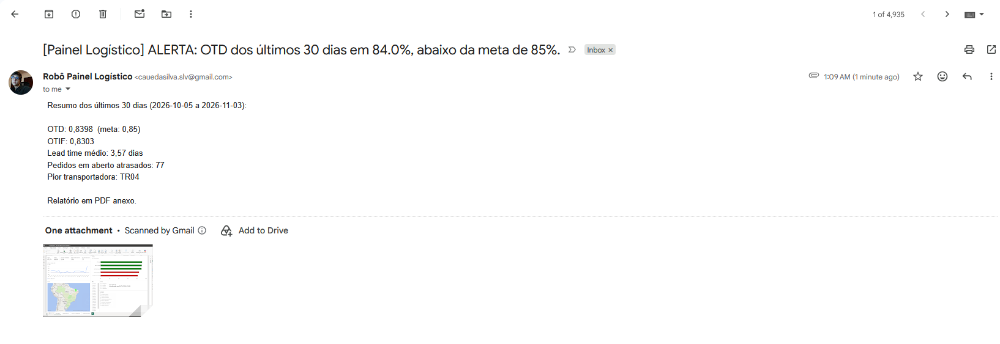

# Painel Logístico – automação RPA + Power BI

Rotina diária de planejamento logístico automatizada de ponta a ponta: um robô do Power Automate Desktop atualiza a base, atualiza o dashboard do Power BI **sem cliques na tela**, salva um print do painel e envia alerta por e-mail quando a entrega no prazo fica abaixo da meta. Empresa e dados **fictícios**.



▶ [Vídeo em resolução cheia](docs/demo.mp4) · ~42 s do clique em **Executar** ao e-mail enviado

```
ERP (relatório diário) → Python (ETL e KPIs) → Power Automate Desktop (robô) → Power BI (refresh via PowerShell) → print + alerta por e-mail
```

## O problema

Todo dia alguém precisa baixar o relatório de pedidos, juntar com a base, atualizar o dashboard, gerar o relatório e avisar a gestão quando a entrega no prazo cai. É manual, repetitivo e sujeito a erro.

## A solução

| Etapa | Ferramenta | O que faz |
|---|---|---|
| Fonte de dados | `gerar_dados.py` | Simula o export diário de um ERP: pedidos novos + mudanças de status (expedido, entregue) |
| ETL | `processar.py` | Valida linhas (datas, chaves, números), rejeita as inválidas com motivo, faz *upsert* por pedido sem regredir status, calcula lead time, atraso, OTD e OTIF e gera um resumo de KPIs com alerta |
| Orquestração | `rotina_diaria.bat` | Ponto único de execução, com código de saída (0 = OK, 2 = alerta, outro = erro) |
| Refresh do Power BI | `scripts/refresh_pbi.ps1` | Conecta no motor Analysis Services local do Power BI Desktop e dispara um refresh completo do modelo. Só retorna quando termina: sem cliques e sem esperas fixas |
| RPA | Power Automate Desktop | Orquestra tudo: roda a rotina, lê os KPIs, abre o `.pbix`, chama o refresh, salva, tira o print e envia o alerta |
| Dashboard | Power BI | Modelo estrela, Power Query parametrizado e medidas DAX de logística |

### Por que não clicar em "Atualizar" pela interface?

A primeira versão usava o gravador do PAD (cliques por imagem). Ela quebrava com qualquer mudança de resolução, escala ou tema. Atualizar o modelo direto pelo motor do Power BI deixa o robô independente da tela e faz ele esperar pelo **fim real do refresh**, não por um tempo chutado.

## KPIs

- **OTD (On-Time Delivery)**: % de pedidos entregues até a data prometida (meta: 85%)
- **OTIF (On-Time In-Full)**: no prazo **e** com a quantidade completa
- **Lead time**: dias entre o pedido e a entrega
- **Tempo de expedição**: dias entre o pedido e a saída do CD
- **Frete % do faturamento** e **frete por kg**
- **Pedidos em aberto atrasados**

## Resultado

| Dashboard atualizado pelo robô | Alerta recebido |
|---|---|
|  |  |

## Como rodar

Requisitos: Windows 10/11, Python 3.10+ (sem bibliotecas externas), Power BI Desktop e Power Automate Desktop (gratuito).

1. Clone o repositório e rode `rotina_diaria.bat` uma vez. A primeira execução gera o histórico (mai/2025 até ontem, ~18 mil pedidos).
2. Rode `scripts\refresh_pbi.ps1` uma vez no PowerShell, para instalar o módulo `SqlServer` (só na primeira vez).
3. Monte o `.pbix` seguindo [`docs/1_power_bi.md`](docs/1_power_bi.md).
4. No Power Automate Desktop, crie um fluxo novo, abra o arquivo [`fluxo/rotina_diaria.txt`](fluxo/rotina_diaria.txt), copie todo o conteúdo e cole no editor (Ctrl+V). Ajuste a variável `PastaProjeto` e o destinatário do e-mail.
5. Clique em **Executar**.

Passo a passo do robô: [`docs/2_power_automate_desktop.md`](docs/2_power_automate_desktop.md)

## Estrutura

```
painel-logistico/
├─ gerar_dados.py          # simula o ERP
├─ processar.py            # ETL + KPIs + alerta
├─ rotina_diaria.bat       # executado pelo robô
├─ scripts/refresh_pbi.ps1 # refresh do Power BI sem interface
├─ fluxo/rotina_diaria.txt # ações do Power Automate Desktop (copiar e colar)
├─ PainelLogistico.pbix    # dashboard
├─ dados/                  # base tratada lida pelo Power BI
├─ entrada/                # relatórios recebidos (e processados/)
├─ logs/                   # processamento.log, rejeitados.csv
├─ relatorios/             # prints diários gerados pelo robô
└─ docs/                   # guias, demo e imagens
```
